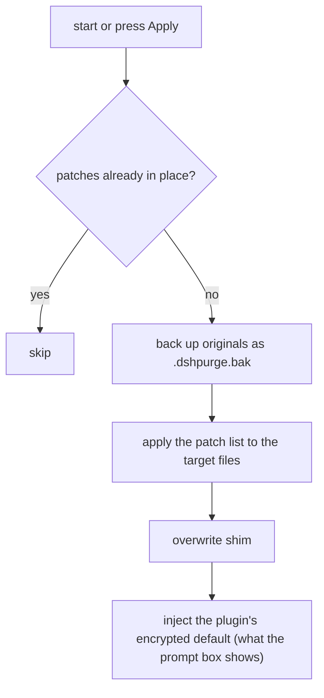
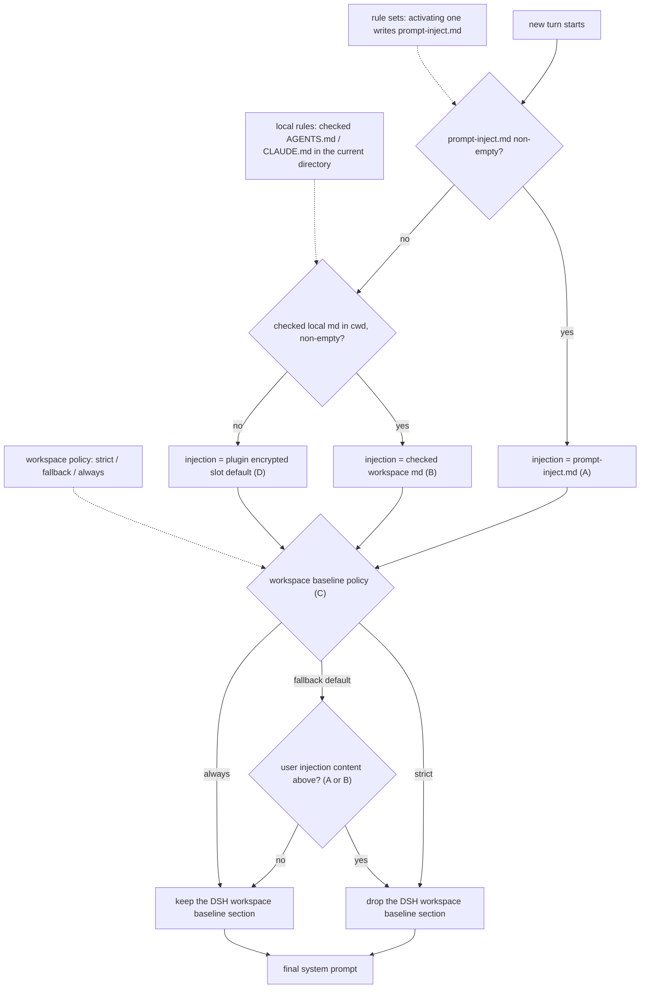

# dsh-purge-fork

<p align="center">
  
</p>

<h1 align="center">🧪 Prompt injection &amp; host patching for DeepSeek Harness</h1>

<p align="center"><strong>Version 1.2.2</strong></p>

<p align="center">
  <em>Take Harness apart: swap the prompt, pick your host patches, and get an "unrestricted" preset in the box. Prompt injection &amp; host patching for DeepSeek Harness.</em>
</p>

<p align="center">
  <a href="https://github.com/P4rfa1t/dsh-purge-fork/stargazers"></a>
  <a href="https://github.com/P4rfa1t/dsh-purge-fork/blob/master/LICENSE"></a>
  <a href="https://www.deepseek.com/harness/"></a>
  <br>
  
  
</p>

<p align="center">
  <a href="README.md"><strong>中文</strong></a> · <a href="README.en.md">English</a>
</p>

---

## What this repository is

**dsh-purge-fork** is a plugin you install on your own machine's [DeepSeek Harness](https://www.deepseek.com/harness/). It does not fork the Harness source tree: it applies **reversible, text-level patches** to the already-installed official `@deepseek-ai/*` packages, and takes over **system-prompt injection** — so both layers become visible, editable and undoable.

Both official surfaces are supported: **Web** (`dsh web`) and the **desktop app** (EXE). They are installed and patched separately.

Two layers are involved, and the plugin keeps them apart:

| Layer | Official behaviour | Where this plugin intervenes |
| --- | --- | --- |
| **Host** | Rewrites the system prompt, approval gates, sandboxing, hooks, desktop update/exit behaviour | A patch list you can browse, group, toggle; every touched file is backed up as `<file>.dshpurge.bak` before writing |
| **Model** | What the model actually answers | Your own injected prompt section plus rule sets, deciding what gets appended each turn |

Only watching "does the model answer" hides host-level interception behind what looks like a model refusal. The point of this plugin is to separate the two: evaluate default policy in a controlled setting and see which behaviours are enforced by the host and which are merely suggested by the prompt.

This plugin only touches the **official packages and local configuration already installed on your own machine**. It is not a public-network scanner and not an attack kit for third-party sites; the repository contains no trojan, no unauthorized penetration tooling and no outbound attack payload.

---

## Contents

- [Feature overview](#feature-overview)
- [How this repository differs from the original](#how-this-repository-differs-from-the-original)
- [UI entry points](#ui-entry-points)
- [Usage](#usage)
- [How it works](#how-it-works)
- [Reverting](#reverting)
- [Updating](#updating)
- [Local checks](#local-checks)
- [Compliance](#compliance)
- [Credits &amp; provenance](#credits--provenance)

---

## Feature overview

| Capability | Details |
| --- | --- |
| **84 host patches** | Prompt disclaimers/strong instructions, approval sentences and approval policy, hooks deny/steer, desktop update hand-off, host exit no longer showing an error dialog — grouped, and groups can be toggled as a whole |
| **Prompt injection** | Writes `$DSH_HOME/prompt-inject.md`; editable, and restorable to the plugin's built-in encrypted default in one click |
| **Rule sets** | Multiple rule sets managed by id: activate / create / delete / reset. Activating writes `AGENTS.md` / `CLAUDE.md` and feeds the injection decision |
| **Official Skill management** | Operates directly on `$DSH_HOME/skills`: list, import an archive or folder, create, delete |
| **Bundled preset** | `presets/unrestricted.patch.yml` — an "unrestricted" preset shipped as a bundle patch, so no local link bundle has to be maintained |
| **Rewind** | "Rewind once" / "Rewind previous turn" / `/rewind`, wired to the official `session.fork({ atSeq })`: the finished turn is withdrawn and a new session picks up the previous context |
| **Retry & continue** | Configurable auto-retry count, auto-continue count and continue text |
| **Hooks bypass switch** | Selectively allow denied hooks, with an explicit bypass flag |
| **Region & banking-domain blocking** | Keeps the original attack-task detection: tasks targeting foreign or banking domains are blocked at the agent pre-step |
| **Desktop asar handling** | Unpacks the desktop package, writes patches into it, and re-applies automatically after an official update |

**Naming &amp; compatibility**: the host patch marker `[dsh-purge]`, the `dsh-purge` prompt-section prefix and the `$DSH_HOME/dsh-purge/` runtime state directory keep their original names, so hosts already patched keep working; the package name, plugin id, client resource id, CLI command and repository URL are now **dsh-purge-fork**.

**Path resolution**: no hard-coded drive letters — it falls back through `$DSH_HOME` → the `.dsh` next to the dsh launcher → `~/.dsh`. Web and desktop each use their own home.

---

## How this repository differs from the original

Original repository: [**YuJunZhiXue/dsh-purge**](https://github.com/YuJunZhiXue/dsh-purge) — the code source of this project (see [Credits &amp; provenance](#credits--provenance)).

This repository is **not** a mirror or a straight sync of upstream. It is a deliberate trimming and reshaping of it:

| Aspect | Original | This repository (dsh-purge-fork) |
| --- | --- | --- |
| **Red-team drill suite** | Ships a full red-team preset, skills, identity switching and related UI | **Removed entirely** (since 1.1.73): presets, skills, UI copy and docs all dropped |
| **Floating entry button** | Has a fixed-position floating button in the bottom-right corner | **Removed** (1.2.0); only the left-sidebar "Clean" glyph and the side panel remain |
| **"Own servers / save list"** | Has an allow-list of exempt hosts (UI + route + `net-scope-allow.txt`) | **Removed as a block** (1.2.0): the allow-list, its route and the related decision logic are gone; region/banking-domain blocking is kept |
| **Identity-stripping patches (#4 / #76)** | Force-clears the official identity sentence | **Patches deleted** — whether the official identity sentence survives is now decided by your own preset |
| **unrestricted preset** | Depends on the deprecated `$DSH_HOME/.agent-presets/` directory | **Shipped with the package**: `presets/unrestricted.patch.yml` is installed as a bundle patch, so the profile no longer needs a local link bundle |
| **Project name** | `dsh-purge` | `dsh-purge-fork`: package name, plugin id, client resource id, CLI (`dsh-purge-fork`), repository URL |
| **Docs** | Document structure follows upstream, mixed with feature blurbs, previews and install notes | **README fully rewritten** to describe this repository as it actually is; plus a manual install guide in [docs/manual-install.en.md](docs/manual-install.en.md) / [docs/manual-install.md](docs/manual-install.md) |
| **Distribution** | Upstream's own channels | Independent repository with automated GitHub Release packaging, MIT licensed |
| **Update self-healing** | Depends on the upstream implementation | Detects the official desktop update via a marker and re-applies patches automatically; the desktop asar unpack/swap flow is retained |

**What was *not* rewritten**: the text-replacement logic of the patches, the prompt-injection chain, the rule-set / Skill management model, the backup-and-revert mechanism and the desktop asar handling flow are all carried over from the original implementation.

---

## UI entry points

- **"Clean" glyph in the left sidebar**: opens the full panel — patch groups, prompt injection, rule sets, Skills, hooks bypass, retry/continue, update channel.
- **Next to the composer**: rewind once / rewind previous turn, plus the continue button.
- **Session opening notice**: a one-time notice with a compliance check.

> There is **no floating ball** in the bottom-right corner (removed in 1.2.0), and **no "Clean" pill** next to the hero row on the home screen (removed in 1.2.2).

---

## Usage

### Chat commands

```text
/purge status      show status
/purge apply       apply everything (prompt + host patches + shim + override)
/purge revert      roll back
/purge uninstall   uninstall the plugin (reverts first if applied)
/purge edit        edit the injection file prompt-inject.md
/purge help        help

/rules list                              list all rule sets
/rules use <id>                          activate a rule set (writes AGENTS.md/CLAUDE.md, joins injection)
/rules create <id> [alias] [target]       create a rule set
/rules delete <id>                       delete a rule set
/rules reset                             reset rule sets
/rules help                              help

/skills list                              list $DSH_HOME/skills
/skills import <path>                    import an archive or folder
/skills create <id> [description]        write <id>/SKILL.md
/skills delete <id>                      delete that directory
/skills help                             help

/rewind                                  rewind once
```

### Model tools

`purge_status` · `purge_apply` · `purge_revert`

### Command line

```sh
dsh-purge-fork --status      # patch and injection status
dsh-purge-fork --apply       # apply
dsh-purge-fork --revert      # revert
dsh-purge-fork --uninstall   # uninstall
dsh-purge-fork --edit        # edit the injection file
dsh-purge-fork --help
```

### Manual installation

If you would rather not use the automatic flow, see [docs/manual-install.en.md](docs/manual-install.en.md) (English) and [docs/manual-install.md](docs/manual-install.md) (Chinese).

### After applying

A successful "Apply" in the settings page restarts the host automatically so the rewritten package files are loaded; you can also restart manually. Patch titles have stable and beta channels.

**When minimal / PTC behaves differently from the standard mode**: if a task runs in standard mode but is blocked in minimal or PTC, the usual cause is that a `run_code` or plan interception sentence in the preset was not cleaned, or that built-in minimal lacks `agent-instructions`. **Fully exit the host → Apply in the Clean panel → let it restart → open a new conversation**, then retry; switching preset alone does not re-apply the patches, so the old process keeps the old behaviour.

### Response latency

DSH runs Bash calls of the same batch sequentially. Patch #21 restores the plugin-marked old wait value to the official 60 seconds. On macOS/Linux with `dsh web`, for faster tool results add this to `$DSH_HOME/profiles/web/cordis.patch.yml`:

```yaml
- id: bash-sandbox
  config:
    timeoutMs: 10000
```

With the standard jobs service and `promoteOnTimeout: true`, an unfinished command returns a background job id after the timeout; read it with `job_output` and stop it with `job_kill`.

### Layout

```
bin/dsh-purge-fork.js    command line entry
lib/                     patches, injection, rules, skills, desktop handling
presets/                 bundled presets (unrestricted.patch.yml)
client.js                sidebar glyph and panel
cordis.patch.yml         the plugin's own profile-layer patch
docs/                    manual install guide, banner, preview images
```

Runtime files live in `$DSH_HOME`: `prompt-inject.md` (your injected prompt), `rules/` (rule sets), `skills/` (official Skill directory) and `dsh-purge/` (state, backups, index). Skills never enter the injection section and never replace the prompt.

---

## How it works

Apply flow (automatic on start, or manual "Apply"):



Per-turn prompt injection and rule-set decision:



---

## Reverting

- Every target file is backed up as `<file>.dshpurge.bak` before it is written.
- "Revert" / `/purge revert` restores from the backup and deletes it; without a backup it only removes the lines this plugin added to the shim.
- `prompt-inject.md` is a user file and survives a revert.
- "Uninstall" reverts first (if applied), then removes the injection file, the rule sets and the plugin itself.
- Applying repeatedly is idempotent: already-marked patches are not rewritten.

---

## Updating

What changed in each version is listed in [Releases](https://github.com/P4rfa1t/dsh-purge-fork/releases) and [release-notes.md](release-notes.md). To publish: bump the version in `package.json`, put the Chinese and English notes at the top of `release-notes.md` (its first line must be `# <version>`), and push to `master` — the release job packages and publishes the zip. Pushing the same version again does not publish twice.

---

## Local checks

```sh
node --check lib/index.js
node --check lib/core.js
node --check lib/rewind.js
node --check lib/skills.js
node --check client.js
node --check bin/dsh-purge-fork.js
```

---

## Compliance

**Disclaimer:** this is a non-profit open-source project. It follows the laws and regulations of its jurisdiction and the rules of the platform where it is used, and is provided for study and research only. It must not be used for anything unlawful; users bear all consequences of their own use.

1. **Nothing unlawful in this repository**: the published code, docs, patches and default prompt are not a trojan, backdoor or unauthorized penetration tool, and target neither the public internet nor third-party systems.
2. **Local official Harness only**: all patching and injection happens on the **official DeepSeek Harness already installed on the user's own machine** (the `@deepseek-ai` packages, the local profile and `$DSH_HOME`) — i.e. the user's own local software.
3. **No outbound traffic to targets**: applying patches, writing injections, reverting and uninstalling all happen within local files and local processes. If the plugin's "check for updates" is enabled, it only contacts this plugin's own GitHub repository to compare versions.
4. **Sole responsibility of the user**: the project is provided "as is" under the MIT license, with no warranty of integrity, security or fitness for a particular purpose. Users are solely responsible for downloading, deploying, running, modifying and redistributing it, and for all consequences.
5. **License terminates on breach**: any person or entity using this project for illegal attacks, malicious activity or other violations loses the software license automatically from the moment the violation occurs.
6. **Independence**: this project has no affiliation, commercial relationship, authorization or endorsement from DeepSeek. "Official" here only means that the object of evaluation is the official DeepSeek Harness installed on the user's own machine.
7. **Attribution required**: if you reuse this project's name, ideas, code or prompts, you must credit it and state the source repository.

---

## Credits &amp; provenance

This project is **not** a from-scratch original. The code comes from:

- **Original author: YuJunZhiXue** — the initial dsh-purge implementation, the host-patch system, the prompt-injection chain and the panel design all originate in that repository. Source: [**YuJunZhiXue/dsh-purge**](https://github.com/YuJunZhiXue/dsh-purge).

**Attribution requirement (inherited from the source repository):** if you use this project's name, ideas, code or prompts, you must credit it and state the source repository — [YuJunZhiXue/dsh-purge](https://github.com/YuJunZhiXue/dsh-purge). The authors reserve the right to act on unattributed, hidden-source or disguised reuse.

**Licensing note**: the source repository switched to a commercial license in one of its versions; the code in this repository is released under the **MIT** license (see [LICENSE](LICENSE), with the original copyright notice preserved). The commercial terms stated in the source repository's README still apply to the source repository's own code; nothing here waives or modifies them.

Thanks to the [LINUX DO](https://linux.do) community.
