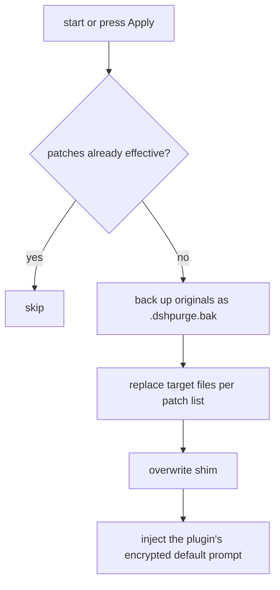

# dsh-purge

<p align="center">
  
</p>

<h1 align="center">🧪 Prompt injection &amp; host patching for DeepSeek Harness</h1>

<p align="center"><strong>Version 1.2.0</strong></p>

<p align="center">
  <em>Take Harness apart: swap the prompt, tune the host patches, and get an "unrestricted" preset in the box. Prompt injection &amp; host patching for DeepSeek Harness.</em>
</p>

<p align="center">
  <a href="https://github.com/P4rfa1t/dsh-purge/stargazers"></a>
  <a href="https://github.com/P4rfa1t/dsh-purge/blob/master/LICENSE"></a>
  <a href="https://awesome-dsh-plugin.com"></a>
  <a href="https://www.deepseek.com/harness/"></a>
  <br>
  
  
</p>

<p align="center">
  <a href="README.md"><strong>中文</strong></a> · <a href="README.en.md">English</a>
</p>

---

## Credits & provenance

This project is **not** a from-scratch original. It continues the work of two upstream authors, and their contribution is what made it possible:

| Upstream | Role | Link |
| --- | --- | --- |
| **YuJunZhiXue** ("小杨同学") | Original author. The initial dsh-purge implementation, the host-patch system, the prompt-injection design and the panel UI all originate in this repository. | [YuJunZhiXue/dsh-purge](https://github.com/YuJunZhiXue/dsh-purge) |
| **kingcharleslzy-ai** | Community fork. Substantial engineering cleanup and community distribution on top of upstream. | [kingcharleslzy-ai/dsh-purge](https://github.com/kingcharleslzy-ai/dsh-purge) |
| **P4rfa1t** | Maintainer of this repository: migration, removal of the red-team module, documentation rewrite, shipping the unrestricted preset. | [P4rfa1t/dsh-purge](https://github.com/P4rfa1t/dsh-purge) |

**Attribution requirement (inherited from upstream):** if you use this project's name, ideas, code or prompts, you must credit it and state the source repository — [YuJunZhiXue/dsh-purge](https://github.com/YuJunZhiXue/dsh-purge). The authors reserve the right to act on unattributed or disguised reuse.

**Licensing note:** upstream switched to a commercial license in one of its versions. The code in this repository is released under the **MIT** license (see [LICENSE](LICENSE)). Upstream's commercial terms still apply to upstream's own code; nothing here waives or modifies them.

---

## Contents

- [Overview](#overview)
- [What changed in 1.2.0](#what-changed-in-120)
- [Supported versions](#supported-versions)
- [Installation](#installation)
- [UI](#ui)
- [Usage](#usage)
- [How it works](#how-it-works)
- [Revert](#revert)
- [Updates](#updates)
- [Local checks](#local-checks)
- [Compliance](#compliance)

---

## Overview

**dsh-purge** is a prompt-injection and host-patching plugin for the official [DeepSeek Harness](https://www.deepseek.com/harness/) installed on your own machine. Both the official **Web** build (`dsh web`) and the official **desktop app** (EXE) are supported; install and apply them separately.

Harness does more than hand your question to a model: it rewrites prompts, gates approvals, manages the sandbox and reshapes the session format at runtime. Watching only "does the model answer" mixes host-level refusals with model-level refusals. This plugin separates the two layers inside your own installation, for controlled evaluation and for seeing whether the defaults should be tightened.

| Surface | What it does |
| --- | --- |
| **Sidebar "Clean"** | The glyph in the left sidebar opens the clean page: patches, prompt, rule sets and skills in one view |
| **Clean page** | Browse patches by group, apply / revert / uninstall; edit the prompt and multiple rule sets |
| **Bundled preset** | `presets/unrestricted.patch.yml` — an "unrestricted mode" preset installed as part of the bundle patch |
| **On start** | Re-checks and re-applies automatically, so an npm upgrade that overwrites `node_modules` needs no manual file edits |

No hard-coded paths. It resolves `$DSH_HOME`, then the `.dsh` next to the dsh launcher, then `~/.dsh`. It never touches the Harness source tree; files are written only when you press "Apply" in the dsh-purge panel. The identity line comes from the plugin's own encrypted prompt — the one shown by default in the prompt box — and never from a prompt file on disk.

This plugin only operates on the official `@deepseek-ai` packages and local configuration you installed yourself. It is not a network scanner and not an attack kit for third-party sites. The repository contains no trojans, no unauthorized intrusion scripts and no outbound attack payloads.

---

## What changed in 1.2.0

- **Removed the floating button in the bottom-right corner.** Older versions pinned a fixed "dsh-purge" bubble to the screen corner, duplicating the panel entry. It is gone in 1.2.0; the left-sidebar glyph and the side panel are unchanged.
- **Removed the "own servers / save list" feature entirely.** The allow-list of exempt hosts (UI, the `/dsh-purge/own-servers` route, `$DSH_HOME/net-scope-allow.txt` and the matching decision logic) has been deleted. The region and bank-domain blocking logic is kept.
- **README fully rewritten.** The old upstream document structure is not reused; the new one describes this repository and credits both upstream authors.
- **The unrestricted preset ships with the package.** `presets/unrestricted.patch.yml` is installed as part of the bundle patch and no longer relies on the retired `$DSH_HOME/.agent-presets/` directory.
- **Identity-stripping patches (#4 / #76) removed.** Whether the official identity line survives is now decided by your own preset.
- **Red-team exercise code fully removed** (since 1.1.73): presets, skills, UI wording and documentation all dropped.

---

## Supported versions

The latest release only supports **dsh 0.2**; do not point it at 0.1.x.

- **dsh 0.2** (official desktop **0.2.1-rc.2** / official `dsh web`): use **1.1.40** or newer. The commands on this page install exactly that.
- **dsh 0.1.7** (incl. rc.1 / rc.2): use **1.1.39** or older — pick the matching tag in [Releases](https://github.com/P4rfa1t/dsh-purge/releases).

Patches that do not match are reported as pending or skipped; no files are mangled.

---

## Installation

Only the official `dsh web` and the official desktop EXE are maintained. Install and apply them **separately**: a Web build cannot consume a desktop bundle and vice versa.

**Web (official `dsh web`)**

```sh
dsh plugin --profile web add dsh-purge
```

**Desktop (official EXE)**

```sh
dsh plugin --profile desktop add dsh-purge
```

If the current directory already is this repository, use `add .` instead. If the registry is unreachable, keep the same `--profile` and point the target at `https://github.com/P4rfa1t/dsh-purge/archive/refs/heads/master.tar.gz`.

### Three steps after installing

Writing the plugin into the profile does **not** modify `@deepseek-ai` by itself.

1. **Quit and relaunch** the host you just installed into: close `dsh web` for Web; for desktop, quit the tray app and reopen the EXE.
2. In **that** host, click the **Clean** glyph in the left sidebar and press **"Apply"** on the clean page. The Harness settings page has no such entry.
3. A successful "Apply" restarts the host once so the patches enter the running process. It does not restart if the patches did not fully apply.

The Web control only touches Web; the desktop control only touches the desktop app. Do not press "Apply" for one host inside the other.

### How to tell it worked

- The **Clean** glyph appears in the left sidebar, and you can press "Apply" inside it.
- `/purge status` in chat prints `DSH_HOME` and the patch list, pointing at the installation you are actually running.
- Optional packages that are not installed (e.g. 梁神) show as skipped and do not block the apply.

### Manual installation

If the command line is unavailable or `dsh` is not on PATH:

1. Find the real `$DSH_HOME`: `DSH_HOME` env var → the `.dsh` next to the install root → `%USERPROFILE%\.dsh` → `%APPDATA%\DeepSeek Harness\dsh-home`. Confirm `profiles/web/package.json` has `"name": "dsh-profile-web"` (desktop: `dsh-profile-desktop`).
2. Put the plugin at `$DSH_HOME/plugins/dsh-purge` (both the directory name and `package.json`'s `"name"` must be `dsh-purge`):

   ```sh
   git clone https://github.com/P4rfa1t/dsh-purge.git "$DSH_HOME/plugins/dsh-purge"
   ```

3. Edit only the matching profile's `package.json` (back it up first) and **add exactly two entries**:

   - `"dsh-purge": "file:../../plugins/dsh-purge"` in `dependencies`
   - `"dsh-purge"` at the **end** of `dsh.profile.bundles`

4. Run `pnpm install` inside that profile directory. Success looks like `profiles/<web|desktop>/node_modules/dsh-purge/package.json` appearing.
5. Fully quit the host, start it again, and press "Apply".

### Uninstall

Sidebar **Clean** → "Clean" → "Uninstall". Confirm in the dialog: applied patches are reverted, the original Harness is restored, and the current host restarts.

```sh
dsh-purge --uninstall
# /purge uninstall
```

---

## UI

Click the **Clean** glyph in the left sidebar to open the clean page. White / ink themes, patches expanded by group, progress counting only items that are actually applied, rule sets listed above with their body below.


| Area | What it holds |
| --- | --- |
| Clean (tab) | Patches, prompt, rule sets, skills |
| Patches | Browse status by group, apply / revert / uninstall |
| Prompt | Edit `prompt-inject.md`, used as the session override |
| Rule sets | Multiple `AGENTS.md` / `CLAUDE.md`; enabling writes to `$DSH_HOME`, deleting removes it from the list |
| Skills | Import a zip or folder into the host's official `$DSH_HOME/skills/<id>/SKILL.md`; matching, loading and `/name` are handled by DSH |

---

## Usage

```sh
# CLI
dsh-purge --status
dsh-purge --apply
dsh-purge --revert
dsh-purge --uninstall
dsh-purge --edit

# In chat
/purge status | apply | revert | uninstall | edit | help
/rules list | use <id> | create <id> | delete <id> | reset | help
/skills list | import <zip-or-folder> | create <id> [note] | delete <id> | help
/rewind

# Model tools
purge_status   purge_apply   purge_revert
```

A successful "Apply" restarts the host to reload the changed package files; you can also restart manually. Each patch title has a stable and a beta channel; the beta channel follows the `beta` branch.

"Undo once" and "Undo previous turn" next to the input box follow the official DSH `session.fork({ atSeq })`: the turn that already ran is withdrawn, a new session continues with the previous context, the old session is archived, and the text returns to the input box — sending it again re-injects. `/rewind` does the same from chat.

**Minimal / PTC disagreeing with standard**: if a task runs in standard mode but is blocked in minimal or PTC, the preset's `run_code` or plan-blocking lines are usually not cleaned. Fully quit the host → apply in the clean page → let it restart → open a new conversation. Switching presets alone does not update the patches inside the old process.

### Responsiveness

DSH runs Bash calls of the same batch sequentially. Patch #21 restores the official 60-second foreground wait for legacy values written by this plugin. On macOS/Linux with `dsh web`, to return tool results sooner add to `$DSH_HOME/profiles/web/cordis.patch.yml`:

```yaml
- id: bash-sandbox
  config:
    timeoutMs: 10000
```

With the standard jobs service and `promoteOnTimeout: true`, unfinished commands return a background job id after the timeout; read them with `job_output` and stop them with `job_kill`.

### Layout

`bin/` is the CLI, `lib/` holds the patches, `presets/` holds the bundled preset (`unrestricted.patch.yml`), `client.js` is the side panel.

Runtime files live in `$DSH_HOME`: `prompt-inject.md`, `rules/`, `skills/`. Without `DSH_HOME`, the `.dsh` next to the dsh install root is used, then `~/.dsh`. Web and desktop each use their own home. Skills never enter the injection segment and never replace the prompt.

---

## How it works

On start, or when you press "Apply":



Per-turn prompt injection and rule-set decision:

```mermaid
flowchart TD
  L["rule library: enable a rule set → write prompt-inject.md"]
  W["local rules: tick this directory's AGENTS.md / CLAUDE.md"]
  P["workspace policy: strict / fallback / always"]

  A["new turn"] --> B{"prompt-inject.md non-empty?"}
  B -->|yes| C["injection = prompt-inject.md (A)"]
  B -->|no| D{"ticked, non-empty local md here?"}
  D -->|yes| E["injection = ticked workspace md (B)"]
  D -->|no| F["injection = plugin encrypted slot default (D)"]
  C --> G{"workspace baseline policy (C)"}
  E --> G
  F --> G
  G -->|strict| H["drop the DSH workspace baseline section"]
  G -->|fallback (default)| I{"user content above? (A or B)"}
  G -->|always| J["keep the DSH workspace baseline section"]
  I -->|yes| H
  I -->|no| J
  H --> K["final system prompt"]
  J --> K

  L -.-> B
  W -.-> D
  P -.-> G
```

---

## Revert

- Every target file is backed up as `<file>.dshpurge.bak` before it is patched.
- "Revert" or `/purge revert` restores from the backup and deletes it; without a backup it removes the lines this plugin wrote into the shim.
- `prompt-inject.md` is a user file and is kept on revert.
- "Uninstall" reverts first (if applied), then removes the injected files, the rule library and the plugin itself.
- Applying repeatedly is idempotent.

---

## Updates

What changed in each version and the installable artifacts are in [Releases](https://github.com/P4rfa1t/dsh-purge/releases). To publish: bump the version in `package.json`, write the Chinese and English notes into `release-notes.md`, and push to `master`; the build is then packaged automatically. Pushing the same version again does not publish twice.

---

## Local checks

```sh
node --check lib/index.js
node --check lib/core.js
node --check lib/rewind.js
node --check lib/skills.js
node --check client.js
```

---

## Compliance

**Disclaimer:** this is a non-profit open-source project, provided for study and research only, in compliance with applicable law. You are solely responsible for any use of it.

1. **No illegal content**: the code, docs, patches and default prompts are not trojans, backdoors or unauthorized intrusion tools, and target no public network or third-party system.
2. **Local official Harness only**: all patches and injections happen inside the official DeepSeek Harness you installed on your own machine (`@deepseek-ai` packages, your profile / `$DSH_HOME`).
3. **No outbound traffic to third-party targets**: applying, injecting, reverting and uninstalling happen within local files and the local process. If update checking is enabled, the plugin only contacts its own GitHub repository to compare versions.
4. **You bear full responsibility**: the project is provided "as is" under MIT, with no warranty of completeness, security or fitness for a particular purpose.
5. **Termination on breach**: any person or entity using this project for illegal attacks, malicious activity or other violations loses the license automatically from the moment the violation occurs.
6. **Independence**: this project is not affiliated with, endorsed by or sponsored by DeepSeek. "Official" only refers to the evaluation target being your own local installation of the official DeepSeek Harness.
7. **Attribution required**: reusing this project's name, ideas, code or prompts requires crediting the source repository.

---

## Credits

- Thanks to [YuJunZhiXue](https://github.com/YuJunZhiXue/dsh-purge) for the original implementation and to [kingcharleslzy-ai](https://github.com/kingcharleslzy-ai/dsh-purge) for the community fork.
- Thanks to the [LINUX DO](https://linux.do) community.
