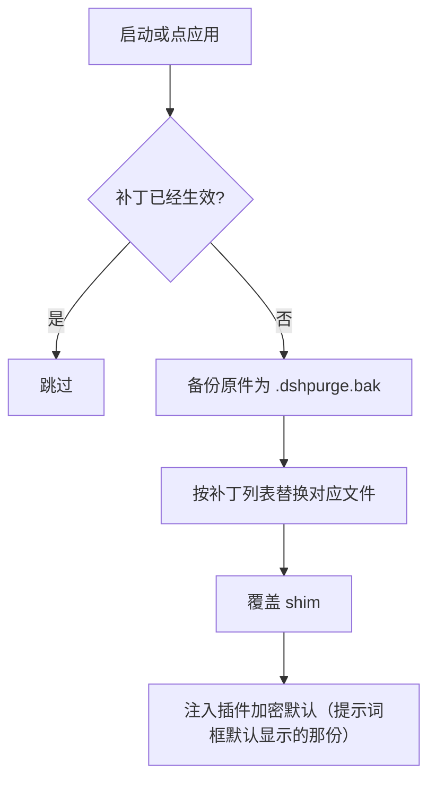
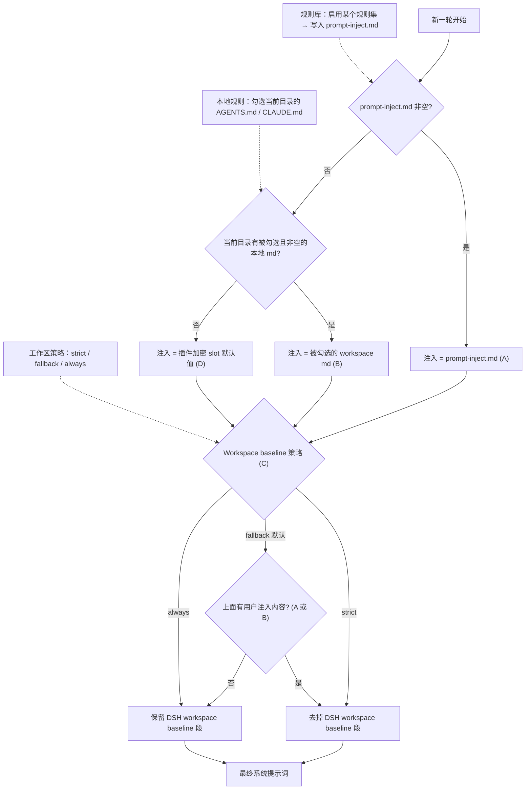

# dsh-purge-fork

<p align="center">
  
</p>

<h1 align="center">🧪 DeepSeek Harness 提示词注入与宿主补丁工具</h1>

<p align="center"><strong>Version 1.2.1</strong></p>

<p align="center">
  <em>把 Harness 的提示词、审批门、hooks 与桌面宿主行为拆开看清楚：可换提示词、可挑补丁、可随包带一个「无限制模式」预设。Prompt injection &amp; host patching for DeepSeek Harness.</em>
</p>

<p align="center">
  <a href="https://github.com/P4rfa1t/dsh-purge-fork/stargazers"></a>
  <a href="https://github.com/P4rfa1t/dsh-purge-fork/blob/master/LICENSE"></a>
  <a href="https://www.deepseek.com/harness/"></a>
  <br>
  
  
</p>

<p align="center">
  <a href="README.md"><strong>中文</strong></a> · <a href="README.en.md">English</a>
</p>

---

## 这个仓库是什么

**dsh-purge-fork** 是一个装在你自己本机 [DeepSeek Harness](https://www.deepseek.com/harness/) 上的插件：它不改 Harness 源码仓库，而是对已安装的官方 `@deepseek-ai/*` 包做**可回滚的文本级补丁**，同时接管**系统提示词的注入**，让这两层行为都能被你看见、改掉、还原。

官方 **Web**（`dsh web`）和官方 **桌面端**（EXE）都支持，两边分开装、分开应用。

要理解它解决什么问题，得先分清两层：

| 层 | 官方行为 | 本插件的介入点 |
| --- | --- | --- |
| **宿主层** | 改写系统提示词、审批门、沙箱、hooks、桌面端退出/更新行为 | 补丁表逐条列出、可单独开关、应用前自动备份为 `<文件>.dshpurge.bak` |
| **模型层** | 模型答什么 | 注入你自己的提示词段 + 规则集，决定每轮追加什么 |

只看「模型答不答」，会把宿主拦截误当成模型拒绝。这个插件的价值就是把两层分开：你在受控环境下评测默认策略，也看清哪些行为是宿主强制的、哪些是提示词诱导的。

本插件只处理**使用者本机已安装的官方包和本机配置**。它不是公网扫描器，不是针对第三方站点的攻击套件；仓库内不含木马、未授权渗透脚本或对外攻击载荷。

---

## 目录

- [功能一览](#功能一览)
- [本仓库与原仓库的区别](#本仓库与原仓库的区别)
- [界面入口](#界面入口)
- [使用](#使用)
- [工作原理](#工作原理)
- [还原](#还原)
- [更新](#更新)
- [本地校验](#本地校验)
- [合规声明](#合规声明)
- [致谢与来源](#致谢与来源)

---

## 功能一览

| 能力 | 说明 |
| --- | --- |
| **84 条宿主补丁** | 提示词免责/强指令、审批提示句与审批策略、hooks deny/steer、桌面端更新交接、host 退出不再弹错误框等，按分组显示，可整组开合 |
| **提示词注入** | 写入 `$DSH_HOME/prompt-inject.md`，可编辑、可一键恢复为插件内置的加密默认值 |
| **规则集** | 多套规则按 id 管理，可激活 / 新建 / 删除 / 重置；激活时写入 `AGENTS.md` / `CLAUDE.md` 并参与注入决策 |
| **官方 Skill 管理** | 直接操作 `$DSH_HOME/skills`：列表、导入压缩包或文件夹、新建、删除 |
| **随包预设** | `presets/unrestricted.patch.yml` —— 一个「无限制模式」预设，作为 bundle patch 一起装进 profile，不用手工维护本地 bundle |
| **回退** | 「回退一次」/「回退上一轮」/ `/rewind`，与官方 `session.fork({ atSeq })` 对接：撤回已进行的那一轮，新会话接上之前的上下文 |
| **重试与续写** | 可配置自动重试次数、自动续写次数与续写文本 |
| **hooks 放行开关** | 把被 deny 的 hooks 按选择放行，可绕过 |
| **地区与银行域名拦截** | 保留原仓库的攻击任务识别：对境外/银行域名的任务在 agent 预检阶段拦截 |
| **桌面端 asar 处理** | 桌面端安装包解包、补丁写入、官方更新后自愈重应用 |

**命名与兼容**：宿主补丁标记 `[dsh-purge]`、提示词段名前缀 `dsh-purge`、`$DSH_HOME/dsh-purge/` 运行时状态目录保留原样，以兼容已经打过补丁的宿主；包名、插件 id、客户端资源 id、CLI 命令与仓库地址已更名为 **dsh-purge-fork**。

**路径解析**：不写死盘符，按 `$DSH_HOME` → dsh 启动器旁边的 `.dsh` → `~/.dsh` 的顺序回落。Web 与桌面端各用自己那一份主目录。

---

## 本仓库与原仓库的区别

原仓库：[**YuJunZhiXue/dsh-purge**](https://github.com/YuJunZhiXue/dsh-purge)（本项目的代码来源，见 [致谢与来源](#致谢与来源)）。

本仓库 **不是** 上游的镜像或简单同步，而是在其基础上做了明确取向的裁剪与改造。差异如下：

| 维度 | 原仓库 | 本仓库 dsh-purge-fork |
| --- | --- | --- |
| **红队演练台** | 含一整套红队预设、技能、身份切换与相关 UI | **全部下线**（1.1.73 起），预设、技能、文案、文档一并移除 |
| **右下角悬浮入口** | 有固定定位的悬浮按钮 | **已删除**（1.2.0），只保留左栏「清洗」图标与侧栏面板 |
| **「自己的服务器 / 保存名单」** | 有例外主机放行名单（UI + 路由 + `net-scope-allow.txt`） | **整块删除**（1.2.0），放行名单、相关路由与判定逻辑全部移除；地区/银行域名拦截保留 |
| **身份句剥离补丁（#4 / #76）** | 强制清空官方身份句 | **补丁删除**，官方身份句是否保留由你自己的预设决定 |
| **unrestricted 预设** | 依赖已废弃的 `$DSH_HOME/.agent-presets/` 目录 | **随包发布**：`presets/unrestricted.patch.yml` 作为 bundle patch 安装，profile 里不再需要本地 link bundle |
| **项目名称** | `dsh-purge` | `dsh-purge-fork`：包名、插件 id、客户端资源 id、CLI（`dsh-purge-fork`）、仓库地址 |
| **文档** | 文档结构随上游演进，且混有功能介绍、预览与安装说明 | **README 完全重写**，按本仓库事实描述；另附 [docs/manual-install.md](docs/manual-install.md) / [docs/manual-install.en.md](docs/manual-install.en.md) 手动安装教程 |
| **发布方式** | 上游自有渠道 | 独立仓库 + GitHub Release 自动打包，MIT 许可 |
| **更新自愈** | 依赖上游实现 | 官方桌面端更新后通过 marker 检测自动重应用补丁；桌面端 asar 解包/换位流程保留 |

**没有做过的改动**：补丁的文本替换逻辑、提示词注入链、规则集/Skill 管理模型、备份与还原机制、桌面端 asar 处理流程，均沿用原实现，未做行为级重写。

---

## 界面入口

- **左栏「清洗」图标**：点开是完整面板 —— 补丁分组、提示词注入、规则集、Skill、hooks 放行、重试续写、更新通道。
- **右侧浮动面板（dock）**：会话内快速查看状态与常用操作。
- **首页 hero 行的小胶囊**：一键打开/收起面板。
- **输入框旁**：回退一次 / 回退上一轮、续写按钮。
- **会话开场提示**：点「检查」走一遍合规自检。

> 屏幕**右下角没有**悬浮球（1.2.0 起已移除该入口）。

---

## 使用

### 聊天命令

```text
/purge status      显示状态
/purge apply       应用全部清洗（提示词 + 宿主补丁 + shim + override）
/purge revert      回滚还原
/purge uninstall   卸载插件（已应用则先还原）
/purge edit        编辑注入文件 prompt-inject.md
/purge help        帮助

/rules list                              列出所有规则集
/rules use <id>                          激活规则（写入 AGENTS.md/CLAUDE.md 并参与注入）
/rules create <id> [别名] [目标]          新建规则
/rules delete <id>                       删除规则
/rules reset                             重置规则
/rules help                              帮助

/skills list                              列出 $DSH_HOME/skills
/skills import <路径>                     导入压缩包或文件夹
/skills create <id> [说明]                写入 <id>/SKILL.md
/skills delete <id>                      删除该目录
/skills help                             帮助

/rewind                                  回退一次
```

### 模型工具

`purge_status` · `purge_apply` · `purge_revert`

### 命令行

```sh
dsh-purge-fork --status      # 查看补丁与注入状态
dsh-purge-fork --apply       # 应用
dsh-purge-fork --revert      # 还原
dsh-purge-fork --uninstall   # 卸载
dsh-purge-fork --edit        # 编辑注入文件
dsh-purge-fork --help
```

### 手动安装

不想走自动安装流程，看 [docs/manual-install.md](docs/manual-install.md)（中文）与 [docs/manual-install.en.md](docs/manual-install.en.md)（English）。

### 应用之后

设置页点「应用」成功后会自动重启宿主，以加载被改写的包文件；也可手动点「重启」。补丁标题下有正式版与测试版通道。

**极简 / PTC 与标准模式行为不一致时**：同一任务在标准模式能跑、在极简或 PTC 被拦，通常是 preset 里 `run_code` 或 plan 拦截句没洗净，或内置 minimal 缺少 `agent-instructions`。请**完全退出宿主 → 清洗里应用 → 自动重启 → 新开一轮对话** 再试；只换 preset 不重应用，旧进程里的补丁不会更新。

### 响应速度

DSH 会按顺序执行同一批中的 Bash 调用。补丁 #21 会把带插件标记的旧等待值恢复为官方的 60 秒。在 macOS/Linux 的 `dsh web` 中如需更快返回工具结果，可在 `$DSH_HOME/profiles/web/cordis.patch.yml` 添加：

```yaml
- id: bash-sandbox
  config:
    timeoutMs: 10000
```

使用标准 jobs 服务且 `promoteOnTimeout: true` 时，未完成的命令会在超时后返回后台任务 id，用 `job_output` 读取、`job_kill` 停止。

### 目录结构

```
bin/dsh-purge-fork.js    命令行入口
lib/                     补丁、注入、规则、Skill、桌面端处理
presets/                 随包预设（unrestricted.patch.yml）
client.js                左栏图标与面板
cordis.patch.yml         插件自身的 profile 层补丁
docs/                    手动安装教程、banner、预览图
```

运行时文件在 `$DSH_HOME`：`prompt-inject.md`（你的注入提示词）、`rules/`（规则库）、`skills/`（官方 Skill 目录）、`dsh-purge/`（状态、备份、索引）。Skill 不进注入段，也不顶替提示词。

---

## 工作原理

应用流程（启动时自动或手动点「应用」）：



每轮的提示词注入与规则集决策：



---

## 还原

- 每个目标文件在应用前备份为 `<文件>.dshpurge.bak`。
- 「还原」或 `/purge revert` 用备份覆盖回去并删除备份；没有备份时只去掉 shim 里由本插件写入的行。
- `prompt-inject.md` 是用户文件，还原时保留。
- 「卸载」会先还原（若已应用），再删除注入文件、规则库和插件本身。
- 重复应用是幂等的：已标记的补丁不会被二次改写。

---

## 更新

每一版改了什么见 [Releases](https://github.com/P4rfa1t/dsh-purge-fork/releases) 与 [release-notes.md](release-notes.md)。发新版时把 `package.json` 的版本号改掉，中英文说明写进 `release-notes.md`（首行必须是 `# <版本>`），推到 `master` 就会自动打包并发布 zip。同一版本再推送不会重复发包。

---

## 本地校验

```sh
node --check lib/index.js
node --check lib/core.js
node --check lib/rewind.js
node --check lib/skills.js
node --check client.js
node --check bin/dsh-purge-fork.js
```

---

## 合规声明

**免责声明：** 本项目为非营利开源项目，遵守国家法律法规及所在平台的相关规范，仅供学习与研究使用。不得将本项目用于任何违法违规用途；由此产生的后果由使用者自行承担。

1. **本仓库不含违法内容**：发布的代码、文档、补丁与默认提示词不是木马、后门、未授权渗透工具，也不针对公网或第三方系统。
2. **只作用于本机官方 Harness**：所有补丁与注入都发生在使用者**本机已安装的官方 DeepSeek Harness**（`@deepseek-ai` 包、本机 profile / `$DSH_HOME`）上，对象是使用者自己的本地软件。
3. **不对外网目标发包**：应用补丁、写入注入、回滚、卸载均在本机文件与本机进程内完成。插件若开启「检测更新」，仅访问本插件自己的 GitHub 仓库以核对版本。
4. **使用者独立承担全部责任**：本项目依据 MIT 协议「按现状」提供，不对完整性、安全性与适用性作任何明示或暗示保证。使用者应对自身的下载、部署、运行、修改、传播行为及全部后果承担独立责任。
5. **违约即终止授权**：任何将本项目用于非法攻击、恶意活动或违规行为的个人或实体，其开源软件使用许可自违法违规行为发生之日起自动终止。
6. **第三方独立性声明**：本项目与 DeepSeek 官方无任何隶属、商业合作、授权或官方背书关系。文中「官方」仅指评测对象为本机安装的官方 DeepSeek Harness。
7. **必须署名**：借用本项目的名称、思路、代码或提示词，必须署名并标明来源仓库。

---

## 致谢与来源

本项目**不是**从零起步的原创工程，代码来源如下：

- **原作者：YuJunZhiXue（叫我小杨同学）** —— dsh-purge 的最初实现、宿主补丁体系、提示词注入链与面板设计均源自其仓库。来源：[**YuJunZhiXue/dsh-purge**](https://github.com/YuJunZhiXue/dsh-purge)。

**署名要求（沿用来源仓库的要求）**：使用本项目的名称、思路、代码或提示词，必须署名并写明来源仓库 —— [YuJunZhiXue/dsh-purge](https://github.com/YuJunZhiXue/dsh-purge)。不署名、隐瞒来源、改头换面据为己有，作者保留追究权利。

**许可说明**：来源仓库在某一版本起改为商业许可，本仓库代码以 **MIT** 发布（见 [LICENSE](LICENSE)，原始版权声明保留）。来源仓库 README 中关于商业许可与使用限制的声明同样适用于来源仓库自身的代码部分；本仓库不对来源仓库的商业条款作任何变更或豁免。

感谢 [LINUX DO](https://linux.do) 社区。
