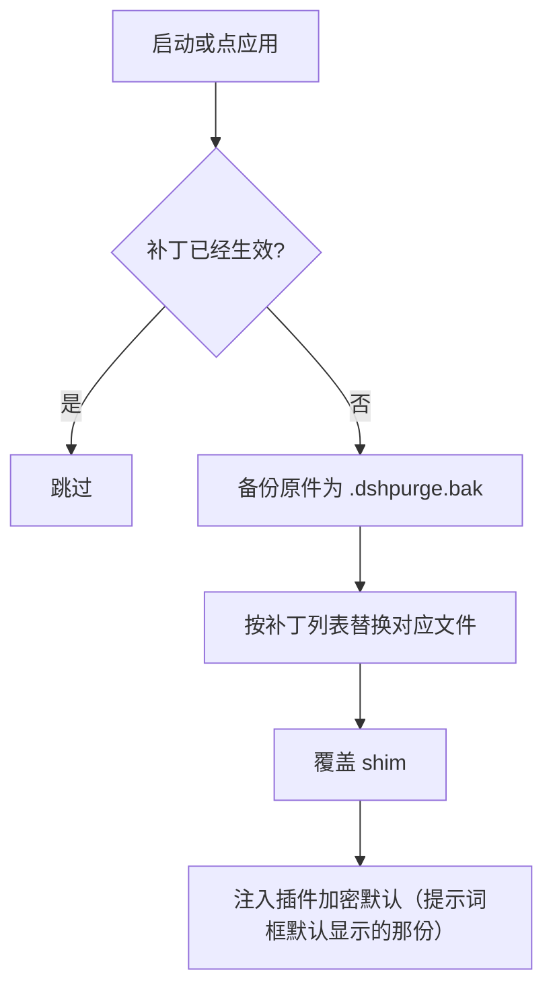
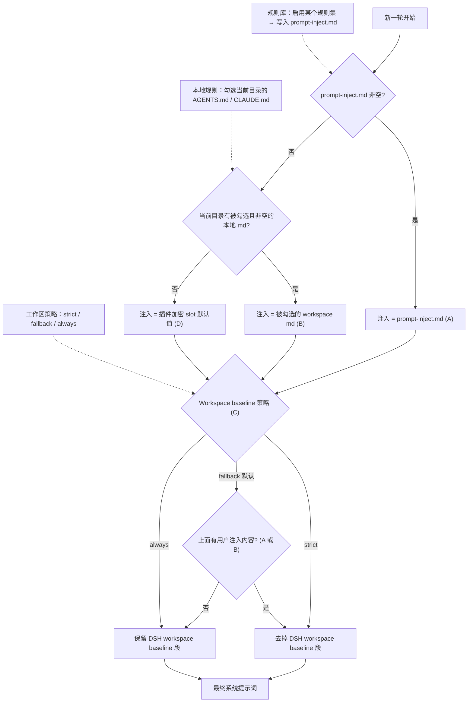

# dsh-purge

<p align="center">
  
</p>

<h1 align="center">🧪 DeepSeek Harness 提示词注入与清洗工具</h1>

<p align="center"><strong>Version 1.2.0</strong></p>

<p align="center">
  <em>把 Harness 的审批门、沙箱和默认提示词拆开看清楚：可换提示词、可调宿主补丁、随包附一个「无限制模式」预设。Prompt injection &amp; host patching for DeepSeek Harness.</em>
</p>

<p align="center">
  <a href="https://github.com/P4rfa1t/dsh-purge/stargazers"></a>
  <a href="https://github.com/P4rfa1t/dsh-purge/blob/master/LICENSE"></a>
  <a href="https://awesome-dsh-plugin.com"></a>
  <a href="https://www.deepseek.com/harness/"></a>
  <br>
  
  
</p>

<p align="center">
  <a href="README.md"><strong>中文</strong></a> · <a href="README.en.md">English</a>
</p>

---

## 来源与致谢

本项目 **不是** 从零起步的原创工程。它承接自两位上游作者的实现与思路，感谢他们的工作：

| 上游 | 角色 | 链接 |
| --- | --- | --- |
| **小杨同学（YuJunZhiXue）** | 原作者。dsh-purge 的最初实现、宿主补丁体系、提示词注入与面板设计均源自其仓库。 | [YuJunZhiXue/dsh-purge](https://github.com/YuJunZhiXue/dsh-purge) |
| **kingcharleslzy-ai** | 社区 fork。在上游基础上做了大量工程整理与社区分发。 | [kingcharleslzy-ai/dsh-purge](https://github.com/kingcharleslzy-ai/dsh-purge) |
| **P4rfa1t** | 本仓库维护者。承接、迁移、去除红队模块、重写文档、随包发布 unrestricted 预设。 | [P4rfa1t/dsh-purge](https://github.com/P4rfa1t/dsh-purge) |

**署名要求（沿用上游要求）**：使用本项目的名称、思路、代码或提示词，必须署名并写明来源仓库 —— [YuJunZhiXue/dsh-purge](https://github.com/YuJunZhiXue/dsh-purge)。不署名、隐瞒来源、改头换面据为己有，作者保留追究权利。

**许可说明**：上游在某一版本起改为商业许可，本仓库代码以 **MIT** 发布（见 [LICENSE](LICENSE)）。上游 README 中关于商业许可与使用限制的声明同样适用于上游自身的代码部分；本仓库不对上游商业条款作任何变更或豁免。

---

## 目录

- [介绍](#介绍)
- [1.2.0 变更](#120-变更)
- [适配范围](#适配范围)
- [安装](#安装)
- [界面预览](#界面预览)
- [使用](#使用)
- [工作原理](#工作原理)
- [还原](#还原)
- [更新](#更新)
- [本地校验](#本地校验)
- [合规声明](#合规声明)

---

## 介绍

**dsh-purge** 是装在本机官方 [DeepSeek Harness](https://www.deepseek.com/harness/) 上的提示词注入与宿主补丁插件。官方 **Web**（`dsh web`）和官方 **桌面端**（EXE）都支持，两边分开装、分开应用。

Harness 不只是把问题交给模型。它还会在运行时改提示词、审批门、沙箱和会话格式。只看「模型答不答」，会把宿主拦截误当成模型拒绝。这个插件在你自己的安装里把这两层分开，用来做受控评测，也用来看默认策略该不该收紧。

| 你会用到 | 它做什么 |
| --- | --- |
| **左栏「清洗」** | 会话左栏的清洗图标打开清洗页：补丁、提示词、规则集、Skill 一屏看完 |
| **清洗** | 分组查看补丁，应用、还原、卸载；编辑提示词和多套规则 |
| **随包预设** | `presets/unrestricted.patch.yml`：一个「无限制模式」预设，作为 bundle patch 一起装进 profile |
| **启动时** | 自动再检查并应用。npm 升级盖掉 `node_modules` 之后不用手改文件 |

不写死盘符。按 `$DSH_HOME`、dsh 启动器旁边的 `.dsh`，再退回 `~/.dsh`。不改 Harness 源码仓库，在 **dsh-purge** 的「清洗」里点「应用」才写入。身份来自插件里的加密提示词，也就是提示词框默认显示的那一份，不读取宿主磁盘上的提示词文件。

本插件只处理使用者本机已安装的官方 `@deepseek-ai` 包和本机配置。它不是公网扫描器，也不是针对第三方站点的攻击套件。仓库内不含木马、未授权渗透脚本或对外攻击载荷。

---

## 1.2.0 变更

- **删除右下角悬浮按钮**。旧版会在屏幕右下角挂一个固定位置的「dsh-purge」悬浮球（与面板入口重复），1.2.0 移除该入口；左栏「清洗」图标和侧栏面板保持不变。
- **删除「自己的服务器 / 保存名单」整块功能**。原用于登记例外主机的放行名单（UI、`/dsh-purge/own-servers` 路由、`$DSH_HOME/net-scope-allow.txt` 与相关判定逻辑）已全部移除。地区与银行域名的拦截逻辑保留。
- **README 完全重写**。不沿用上游旧文档结构，改为本仓库事实描述，并补上对上游两位作者的致谢与署名声明。
- **unrestricted 预设随包发布**。`presets/unrestricted.patch.yml` 作为 bundle patch 的一部分装入 profile，不再依赖已废弃的 `$DSH_HOME/.agent-presets/` 目录。
- **身份句剥离补丁（#4 / #76）删除**。官方身份句是否保留由你自己的预设决定，不再由插件强制清空。
- **红队演练相关代码全部下线**（1.1.73 起）：预设、技能、UI 文案与文档一并移除。

---

## 适配范围

最新版只支持 **dsh 0.2**，不要拿它去打 0.1.x。

- **dsh 0.2**（官方桌面 **0.2.1-rc.2** / 官方 `dsh web`）：用 **1.1.40** 及以上。本页命令装的就是这一档。
- **dsh 0.1.7**（含 rc.1 / rc.2）：用 **1.1.39** 及更早 —— 在 [Releases](https://github.com/P4rfa1t/dsh-purge/releases) 里选对应标签。

对不上的补丁会显示待应用或跳过，不会乱改文件。

---

## 安装

现在只维护官方 `dsh web` 和官方桌面 EXE，**两边都要装、分开应用**。Web 的包进不了桌面端，桌面端的包也进不了 Web。

**Web（官方 `dsh web`）**

```sh
dsh plugin --profile web add dsh-purge
```

**桌面端（官方 EXE）**

```sh
dsh plugin --profile desktop add dsh-purge
```

当前目录已经是本仓库时，把包名换成 `add .`。registry 上不去：同一个 `--profile`，把目标换成 `https://github.com/P4rfa1t/dsh-purge/archive/refs/heads/master.tar.gz`。

### 装完都要做这三步

只把插件写进 profile **还不会**改 `@deepseek-ai`。

1. **退出并重新打开**刚装的那个宿主：Web 关掉 `dsh web` 再开；桌面端退出托盘再打开对应 exe。
2. 在**这个宿主**的左栏点 **清洗** 图标，在 **清洗** 页点 **「应用」**。宿主的设置页里没有这个条目。
3. 「应用」成功后会自动重启一次，让补丁进入当前进程。没做完不会重启。

Web 的控件只动 Web，桌面端的只动桌面应用。不要在一个宿主里点另一个宿主的应用。

### 怎样算装上了

- 左栏出现 **清洗** 图标，点开后在「清洗」里能点「应用」。
- 聊天里 `/purge status` 能打出 `DSH_HOME` 和补丁列表，路径应是你正在用的那一份。
- 没装的可选包（例如梁神）显示跳过，不挡住应用完成。

### 手动安装

命令行装不上、或 `dsh` 不在 PATH 时用这个。只改**正在用的那个宿主**对应的 profile，不要动另一个，也不要删原有 bundle。

1. 找到真正在用的 `$DSH_HOME`：`DSH_HOME` 环境变量 → 安装根旁边的 `.dsh` → `%USERPROFILE%\.dsh` → `%APPDATA%\DeepSeek Harness\dsh-home`。确认 `profiles/web/package.json` 的 `"name"` 是 `dsh-profile-web`（桌面是 `dsh-profile-desktop`）。
2. 把插件放到 `$DSH_HOME/plugins/dsh-purge`（目录名与 `package.json` 的 `"name"` 都必须是 `dsh-purge`）：

   ```sh
   git clone https://github.com/P4rfa1t/dsh-purge.git "$DSH_HOME/plugins/dsh-purge"
   ```

3. 只改对应 profile 的 `package.json`，先备份。**只追加两处**：

   - `dependencies` 增加 `"dsh-purge": "file:../../plugins/dsh-purge"`
   - `dsh.profile.bundles` **末尾**追加 `"dsh-purge"`

4. 在该 profile 目录里 `pnpm install`。成功标志是 `profiles/<web|desktop>/node_modules/dsh-purge/package.json` 出现。
5. 完全退出该宿主，再启动，点「应用」。

### 卸载

左栏 **清洗** →「清洗」→「卸载」。弹窗确认：会先还原已应用的补丁，还原回原版 Harness，再重启当前宿主。

```sh
dsh-purge --uninstall
# /purge uninstall
```

---

## 界面预览

左栏点 **清洗** 图标打开清洗页。白 / 墨可切换，补丁按组展开，进度只计真正已应用的项。规则集在上方列表启用或删除，下方编辑正文。


| 区域 | 说明 |
| --- | --- |
| 清洗（页签） | 补丁、提示词、规则集、Skill |
| 补丁 | 分组查看状态，应用、还原或卸载 |
| 提示词 | 编辑 `prompt-inject.md`，作为会话覆盖段 |
| 规则集 | 多套 `AGENTS.md` / `CLAUDE.md`；启用写入 `$DSH_HOME`，删除从列表去掉 |
| Skill | 导入压缩包或文件夹到当前宿主官方目录 `$DSH_HOME/skills/<id>/SKILL.md`；命中、加载、`/名称` 由 DSH 负责 |

---

## 使用

```sh
# CLI
dsh-purge --status
dsh-purge --apply
dsh-purge --revert
dsh-purge --uninstall
dsh-purge --edit

# 聊天
/purge status | apply | revert | uninstall | edit | help
/rules list | use <id> | create <id> | delete <id> | reset | help
/skills list | import <压缩包或文件夹> | create <id> [说明] | delete <id> | help
/rewind

# 模型工具
purge_status   purge_apply   purge_revert
```

设置页「应用」成功后会自动重启，以加载已改的包文件；也可手动点「重启」。补丁标题下有正式版和测试版，测试版跟 `beta` 分支。

输入框旁的「回退一次」和「回退上一轮」跟官方 DSH `session.fork({ atSeq })`：撤回已进行的那一轮，新会话接上之前的上下文，旧会话归档，那句回到输入框，再发送会重新注入。聊天里 `/rewind` 同样可用。

**极简 / PTC 与标准不一致时**：同一任务在标准模式能跑、在极简或 PTC 被拦，通常是 preset 里 `run_code` 或 plan 拦截句没洗净，或内置 minimal 缺少 `agent-instructions`。请**完全退出宿主 → 清洗里应用 → 自动重启 → 新开一轮对话** 再试；只换 preset 不重应用，旧进程里的补丁不会更新。

### 响应速度

DSH 会按顺序执行同一批中的 Bash 调用。补丁 #21 会把带插件标记的旧等待值恢复为官方的 60 秒。在 macOS/Linux 的 `dsh web` 中如需更快返回工具结果，可在 `$DSH_HOME/profiles/web/cordis.patch.yml` 添加：

```yaml
- id: bash-sandbox
  config:
    timeoutMs: 10000
```

使用标准 jobs 服务且 `promoteOnTimeout: true` 时，未完成的命令会在超时后返回后台任务 id，用 `job_output` 读取、`job_kill` 停止。

### 目录结构

`bin/` 是命令行，`lib/` 是补丁，`presets/` 是随包预设（`unrestricted.patch.yml`），`client.js` 是侧栏。

运行时文件在 `$DSH_HOME`：`prompt-inject.md`、`rules/`、`skills/`。未设 `DSH_HOME` 时，优先用 dsh 安装目录旁边的 `.dsh`，再退回 `~/.dsh`。Web 和桌面端各用自己那一份主目录。Skill 不进注入段，也不顶替提示词。

---

## 工作原理

应用，启动时或手动点「应用」：



每一轮的提示词注入与规则集决策：



---

## 还原

- 每个目标文件在应用前备份为 `<文件>.dshpurge.bak`。
- 「还原」或 `/purge revert` 用备份覆盖回去并删除备份；没有备份时去掉 shim 里由本插件写入的行。
- `prompt-inject.md` 是用户文件，还原时保留。
- 「卸载」会先还原（若已应用），再删除注入文件、规则库和插件本身。
- 重复应用是幂等的。

---

## 更新

每一版改了什么、安装包在 [Releases](https://github.com/P4rfa1t/dsh-purge/releases)。发新版时把 `package.json` 的版本号改掉，中英文说明写进 `release-notes.md`，推到 `master` 就会自动打包。同一版本再推送不会重复发包。

---

## 本地校验

```sh
node --check lib/index.js
node --check lib/core.js
node --check lib/rewind.js
node --check lib/skills.js
node --check client.js
```

---

## 合规声明

**免责声明：** 本项目为非营利开源项目，遵守国家法律法规及所在平台的相关规范，仅供学习与研究使用。不得将本项目用于任何违法违规用途；由此产生的后果由使用者自行承担。

1. **本仓库不含违法内容**：发布的代码、文档、补丁与默认提示词不是木马、后门、未授权渗透工具，也不针对公网或第三方系统。
2. **只作用于本机官方 Harness**：所有补丁与注入都发生在使用者**本机已安装的官方 DeepSeek Harness**（`@deepseek-ai` 包、本机 profile / `$DSH_HOME`）上，对象是使用者自己的本地软件。
3. **不对外网目标发包**：应用补丁、写入注入、回滚、卸载均在本机文件与本机进程内完成。插件若开启「检测更新」，仅访问本插件自己的 GitHub 仓库以核对版本。
4. **使用者独立承担全部责任**：本项目依据 MIT 协议「按现状」提供，不对完整性、安全性与适用性作任何明示或暗示保证。使用者应对自身的下载、部署、运行、修改、传播行为及全部后果承担独立责任。
5. **违约即终止授权**：任何将本项目用于非法攻击、恶意活动或违规行为的个人或实体，其开源软件使用许可自违法违规行为发生之日起自动终止。
6. **第三方独立性声明**：本项目与 DeepSeek 官方无任何隶属、商业合作、授权或官方背书关系。文中「官方」仅指评测对象为本机安装的官方 DeepSeek Harness。
7. **必须署名**：借用本项目的名称、思路、代码或提示词，必须署名并标明来源仓库。

---

## 致谢

- 感谢 [小杨同学（YuJunZhiXue）](https://github.com/YuJunZhiXue/dsh-purge) 的原创实现与 [kingcharleslzy-ai](https://github.com/kingcharleslzy-ai/dsh-purge) 的社区 fork。
- 感谢 [LINUX DO](https://linux.do) 社区。
